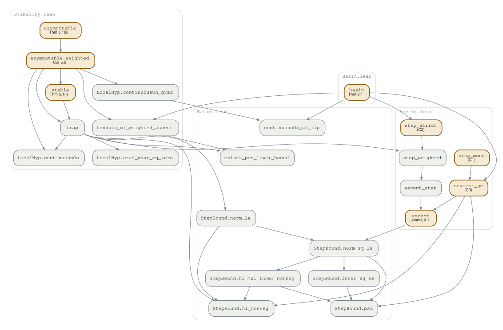

# Lean 4 formalization: discrete modified-gradient stability

[](https://arxiv.org/abs/2611.14756)
[](https://doi.org/10.5281/zenodo.24118844)
[](https://github.com/magbenji/discrete-modified-gradient-lean/actions/workflows/lean_action_ci.yml)

Machine-checked proofs (Lean 4 + Mathlib) of the core results of the manuscript
*Stability of equilibria in discrete-time modified-gradient systems and the multivariate
breeder's equation* by B. J. Ridenhour
([arXiv:2611.14756](https://arxiv.org/abs/2611.14756); submitted for publication). Section, lemma and theorem numbers below
refer to that manuscript (arXiv v1). Every theorem below compiles with
no `sorry` and depends only on Lean's three standard axioms (`propext`, `Classical.choice`,
`Quot.sound`).

| Paper | Lean name | File |
|---|---|---|
| Lemma 4.1 (one-step ascent) | `ascent`, `ascent_step` | `DiscreteStability/Ascent.lean` |
| (C1) | `step_mono` | `Ascent.lean` |
| (C2) | `step_strict` | `Ascent.lean` |
| (C3) | `segment_ge` | `Ascent.lean` |
| weighted decrease (used in Cor. 5.2) | `step_weighted` | `Ascent.lean` |
| Theorem 5.1(i) | `stable` | `DiscreteStability/Stability.lean` |
| Theorem 5.1(ii) | `asympStable` | `Stability.lean` |
| Corollary 5.2 | `asympStable_weighted` | `Stability.lean` |
| Theorem 6.1 | `basin` | `DiscreteStability/Basin.lean` |

## Dependency graph

An arrow from A to B means the proof of A cites B. The paper's results are highlighted, and
boxes are grouped by file. Definitions and hypotheses (`StepBound`, `LocalHyp`, `IsOrbit`, ...)
and Mathlib lemmas are left out.
The [interactive version](https://magbenji.github.io/discrete-modified-gradient-lean/) lets you
click a declaration to trace what it depends on and what depends on it, optionally shows the
definitions too, and lists every declaration with links to its source line.

<picture>
  <source media="(prefers-color-scheme: dark)" srcset="docs/dependency-graph-dark.svg">
  
</picture>

Lemma 4.1 (`ascent`) underlies every result. Theorem 5.1 and Corollary 5.2 go through the
trapping lemma `trap`, Theorem 6.1 uses (C2) and (C3), and Corollary 5.2 and Theorem 6.1 share
the convergence argument `tendsto_of_weighted_ascent`. (C1) (`step_mono`) is proved for
completeness but is not used by the other results.

Both versions are generated from the source by `python3 scripts/dependency_graph.py`
(requires Graphviz). It writes the static images and their Graphviz source
(`docs/dependency-graph.dot`) and the interactive page `docs/index.html`, which GitHub Pages
serves from the `docs/` folder.

## How the paper's hypotheses are encoded

* **Space.** A real inner product space `E` (for example `EuclideanSpace ℝ (Fin n)`).
  Theorem 5.1 and Corollary 5.2 assume `[FiniteDimensional ℝ E]` so that closed balls are compact.
  Theorem 6.1 needs no such assumption, because compactness of `closure U` is a hypothesis (H4).
* **Gradient.** `f : E → ℝ` with gradient `g : E → E`, written
  `HasFDerivAt f (innerSL ℝ (g z)) z` (that is, `Df(z) h = ⟪g z, h⟫`).
* **Lipschitz bound.** `‖g u - g v‖ ≤ L * ‖u - v‖` on the closed ball `B̄_{r₀}(x̄)`
  (Section 5, structure `LocalHyp`) or on `closure U` (Section 6).
* **Step matrices.** `P k : E →L[ℝ] E` together with `StepBound (P k) (lo k) (hi k)`. This says
  `P k` is symmetric and `lo k ‖u‖² ≤ ⟪P k u, u⟫ ≤ hi k ‖u‖²` with `0 ≤ lo k ≤ hi k`. For a
  symmetric matrix this means exactly `lo k ≤ λ₁(P_k)` and `λₙ(P_k) ≤ hi k`. Taking
  `lo k = λ₁(P_k)` and `hi k = λₙ(P_k)` gives the paper's statements; any weaker pair of bounds
  also works.
* **Hypotheses H1–H3 and S1–S2.**
  * H1 is `IsolatedMax f x̄`.
  * H2 is `IsolatedCrit g x̄`.
  * H3_Δ is `Tendsto (fun N => ∑ k < N, lo k) atTop atTop`.
  * S1 is `L * Λ ≤ 2` with `hi k ≤ Λ`.
  * S2 is `L * Λ ≤ 2 - η` with `0 < η`.
* **Iteration (Δ).** `IsOrbit P g k₀ x` means `x (k+1) = x k + P k (g (x k))` for all `k ≥ k₀`.
* **Stability.** `UniformlyStable` and `UniformlyAsympStable` are the paper's definitions with
  `k_ε = 0`, so `δ` does not depend on the starting index `k₀`.
* **Theorem 6.1.** It is stated for any open set `U ∋ x̄` with the properties of `E_c` that the
  proof uses:
  * `c < f` on `U`, and `f < f x̄` on `U \ {x̄}`;
  * H4: `closure U` is compact;
  * H5: `f = c` on `frontier U`;
  * H6: `g ≠ 0` on `closure U \ {x̄}`;
  * S3, and H3_Δ.

  The component `E_c` of the paper is one such set.

### Small differences from the written proofs

* **Theorem 5.1(i).** The paper picks `ρ` using `Γ(ρ) = max_{|x-x̄|≤ρ} |∇f|`. The Lean proof
  instead uses `ρ = r/4` together with `|∇f(x)| ≤ L|x - x̄|`, which follows from `∇f(x̄) = 0` and
  the Lipschitz bound. With S1 this keeps every step inside `B_r(x̄)`.
* **Theorem 6.1.** The paper argues with `t* = sup T`, the last time the segment is still inside.
  The Lean proof uses the first exit time `s₀ = inf {s ∈ [0,1] : x + s d ∉ U}`. Lemma 4.1 is
  applied on `[0, s₀]`, so `ascent` is stated for a segment `[0, t]`.
* **Shared convergence argument.** The convergence step common to Theorem 5.1(ii),
  Corollary 5.2 and Theorem 6.1 is proved once, as `tendsto_of_weighted_ascent`.

## Checking that it compiles

You need `elan`, the Lean version manager. Install it once on macOS or Linux with:

```bash
curl https://elan.lean-lang.org/elan-init.sh -sSf | sh
```

Then restart the terminal. Alternatively, install the **Lean 4** extension in VS Code, which
offers to install elan for you.

Clone the repository and build:

```bash
git clone https://github.com/magbenji/discrete-modified-gradient-lean.git
cd discrete-modified-gradient-lean
lake exe cache get            # downloads prebuilt Mathlib (a few GB, a few minutes)
lake build                    # compiles the four files
```

`lake build` should end with `Build completed successfully`. Lean prints
`declaration uses 'sorry'` for any unfinished proof, and there are none.

To list the axioms each main theorem relies on, run:

```bash
lake env lean Axioms.lean
```

Each line should read `depends on axioms: [propext, Classical.choice, Quot.sound]`.

The first `lake` command downloads the exact Lean version pinned in `lean-toolchain`
(`v4.35.0`) and the Mathlib commit pinned in `lake-manifest.json`. If you skip
`lake exe cache get`, `lake build` compiles about 2,500 Mathlib files from source, which takes
roughly an hour.

To read the proofs interactively, open this folder in VS Code with the Lean 4 extension. Then
click inside any proof to see the goal state.

The GitHub Actions workflow in `.github/workflows/` runs the same build and axiom check on every
push; the badge at the top shows its latest result.

## Citation and license

If you use this code, please cite the paper (see `CITATION.cff`):

> B. J. Ridenhour, Stability of equilibria in discrete-time modified-gradient systems and the
> multivariate breeder's equation, arXiv:2611.14756 [math.DS], 2026.
> https://doi.org/10.48550/arXiv.2611.14756

To cite the code itself, use the Zenodo archive: https://doi.org/10.5281/zenodo.24118844.

The code is released under the
Apache License 2.0 (see `LICENSE`), the same license as Mathlib.
